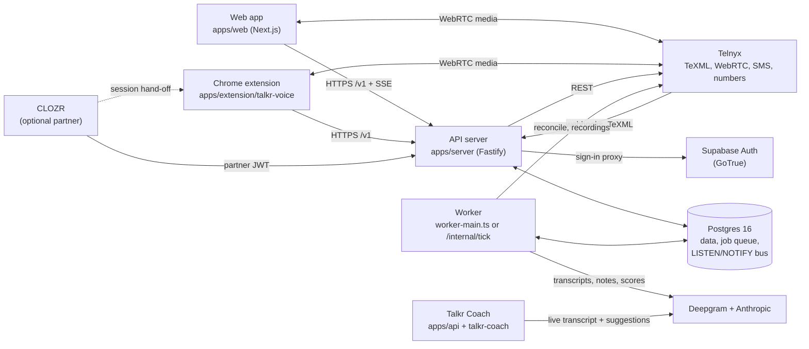
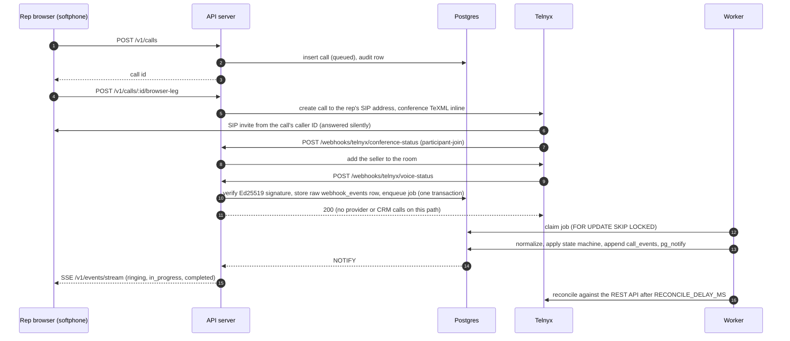
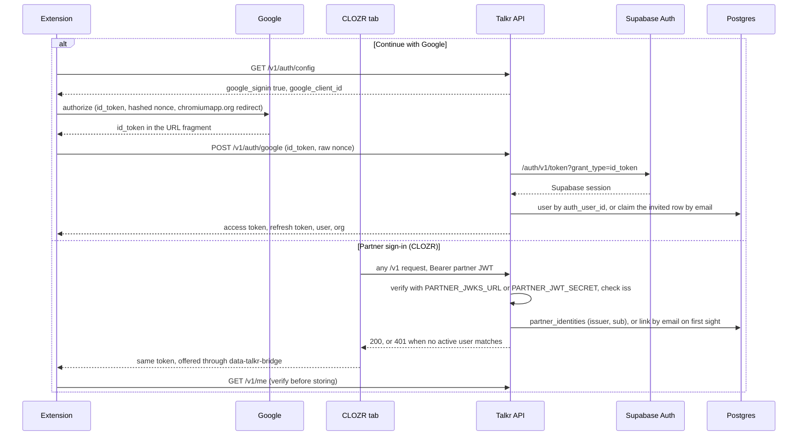

# Talkr

Talkr is an open-source calling and SMS platform for small sales teams that work
leads by phone. Reps call and text from a browser (the web app or a Chrome
extension), every call is stored as an event-sourced record in your own
Postgres, and an optional AI layer transcribes, summarizes and scores calls.
Telnyx is the carrier, behind an adapter.

The repository holds two systems:

1. **Talkr Platform** (`apps/server`, `apps/web`, `apps/extension/talkr-voice`,
   `packages/*`): browser calling, SMS inbox, dialers, inbound routing,
   reporting, a public API, and integrations with Podio and the CLOZR CRM.
2. **Talkr Coach** (`apps/api`, `apps/extension/talkr-coach`, `supabase/`): a
   separate real-time coaching overlay for calls placed in a web dialer tab,
   plus an offline pipeline that turns past recordings into a searchable
   pattern library.

**Status:** pre-1.0 (`0.1.0`). The Platform test suite (79 files, 828 tests)
runs the real Fastify app, worker and migrations against Postgres 16. A few
Telnyx behaviours are not yet confirmed against a live account; they are listed
in [docs/telnyx-setup.md](docs/telnyx-setup.md) under "Still unverified". The
predictive dialer is built but switched off. The scripts, prompts and playbook
files are short examples to replace with your own.

- Full setup guide: [SETUP.md](SETUP.md)
- Setup with an AI coding assistant: [SETUP-WITH-AI.md](SETUP-WITH-AI.md)
- Design docs: [docs/architecture.md](docs/architecture.md)

## Contents

- [Architecture](#architecture)
- [Features](#features)
- [Quick start (local, no carrier)](#quick-start-local-no-carrier)
- [Production setup](#production-setup)
- [OAuth and partner sign-in](#oauth-and-partner-sign-in)
- [Environment variables](#environment-variables)
- [Project layout](#project-layout)
- [Testing](#testing)
- [Contributing](#contributing)
- [Security](#security)
- [License](#license)

## Architecture

Postgres is the source of truth. The browser is a view of server state. Every
carrier webhook is stored raw before it is processed, processing is idempotent,
and finished calls are reconciled against the carrier's REST API.

### System



The worker runs as its own process (`npm run worker:dev`), inside the API
process (`WORKER_INLINE=true`), or, on a serverless host, as a once-a-minute
cron call to `GET /internal/tick` (`apps/server/src/serverless.ts`), which
runs only with `Authorization: Bearer <CRON_SECRET>`.

### Call lifecycle (outbound browser call)



Call states: `queued`, `initiated`, `ringing`, `in_progress`, then one of
`completed`, `no_answer`, `busy`, `failed`, `canceled`
(`packages/core/src/call-state.ts`). Full detail:
[docs/telephony-events.md](docs/telephony-events.md) and
[docs/telnyx-setup.md](docs/telnyx-setup.md) section 6.

### Sign-in



Email and password sign-in (`POST /v1/auth/login`) follows the Google path with
a password grant in place of the id_token grant. The web app offers email and
password; the Google button is in the Chrome extension.

## Features

### Calling
- Browser softphone on `@telnyx/webrtc`; the server opens the rep's leg (`POST /v1/calls/:id/browser-leg`) and the browser answers it silently (`apps/web/lib/softphone-engine.ts`).
- Calls run in a conference room by default, so hold, add call, merge, and warm or blind transfer are server operations (`CALL_CONTROL_MODE=conference`; `bridge` is the two-leg fallback).
- Suppression (DNC) check before every outbound call (`apps/server/src/services/calls.ts`).
- Wrap-up with dispositions after each call; the default set includes a DNC disposition that adds suppression (`apps/server/src/seed.ts`).
- Manager monitoring: listen, whisper and barge on a live call (`/v1/calls/:id/monitor`, `packages/core/src/conference.ts`).
- Outbound AI calls through Telnyx AI Assistants, with the same suppression and caller-ID rules (`/v1/ai-calls`, [docs/live-ai.md](docs/live-ai.md)).

### Inbound routing
- Routing chain: business hours, caller recognition to the assigned rep, the number's user, the number's team (simultaneous ring), external forward, then voicemail ([docs/inbound-routing.md](docs/inbound-routing.md)).
- Per-number call flows (IVR, queues, whisper, missed-call text) with a simulator (`/v1/numbers/:id/routing`, `/v1/numbers/:id/routing/simulate`).

### Dialers
- Campaigns of leads with power, progressive and parallel dial sessions (`/v1/campaigns`, `/v1/dial-sessions`, [docs/dialers.md](docs/dialers.md)).
- Calling windows, per-day and total attempt caps, and a 3% abandonment cap that drops parallel dialing to one line.
- Answering-machine detection with hang-up or voicemail drop (`packages/core/src/dialer.ts`).
- Predictive pacing is built but off (`DIALER_PREDICTIVE_ENABLED`).

### SMS inbox
- Shared two-way inbox, one message per send, delivery tracking (`/v1/messages`, `/v1/conversations`, [docs/sms.md](docs/sms.md)).
- STOP, HELP and START handling, suppression and quiet hours on every send.
- Message templates with merge fields and preview (`/v1/message-templates`).

### Contacts, scripts and follow-up
- Contacts with type, status, tags, hot/warm/cold temperature, CSV import and export (`/v1/contacts`, [docs/contacts.md](docs/contacts.md)).
- Scripts and objection rebuttals with merge fields, served with lead context in one read (`GET /v1/call-context`, [docs/scripts.md](docs/scripts.md)).
- Workflows ("when X, do Y") and tasks (`/v1/workflows`, `/v1/tasks`, [docs/workflows.md](docs/workflows.md)).
- Sequences (text, wait, text again, stop on reply) with an optional AI draft (`/v1/sequences`, `POST /v1/ai/sequence-draft`, [docs/sequences.md](docs/sequences.md)).

### Call history and recordings
- Call history with filters and CSV export (`/v1/history`, `/v1/history/export.csv`).
- Dual-channel recordings mirrored by a worker job and played through the API (`/v1/recordings/:id/audio`).
- Deepgram transcripts and Anthropic call notes, retried automatically on media errors (`/v1/calls/:id/transcript`, [docs/transcription.md](docs/transcription.md)).

### Team and roles
- Roles `owner > admin > manager > rep`, expanded to permission strings in code (`packages/core/src/rbac.ts`); routes check permissions before running.
- Team page: invite by email, change role, title, default number and status (`/v1/team/members`); invites send a Supabase email when `SUPABASE_SERVICE_ROLE_KEY` is set.
- Each teammate's local time shown on the transfer list.

### Numbers and caller ID
- Search and buy Telnyx numbers through the API, or import numbers the account already owns (`GET /v1/numbers/available`, `POST /v1/numbers`, `/v1/numbers/carrier`, `/v1/numbers/import`); the web app lists and edits them.
- Caller ID per call: campaign number, rep override, local presence (area-code match), rep default, assigned line (`apps/server/src/services/caller-id.ts`).
- Number reputation from Talkr's own call and message history plus cached carrier data (CNAM, 10DLC) per line (`/v1/numbers/:id/reputation`, `/v1/reputation/summary`).

### Reporting
- Overview, by rep, by day, call quality, queues and carrier cost reports in the org's timezone (`/v1/reports/*`, [docs/reporting.md](docs/reporting.md)).
- Floor view of live calls and rep presence, refreshed over SSE (`/v1/floor/state`).

### Integrations
- Podio: call activity sync when all four `PODIO_*` variables are set ([docs/podio-integration.md](docs/podio-integration.md)).
- CLOZR partner: CLOZR signs reps in with its own JWT; Talkr links them by email and allows CLOZR's browser origins (`apps/server/src/partners.ts`).
- Public REST API under `/api/v1/*` with hashed, scoped `tk_live_…` keys and rate limits ([docs/public-api.md](docs/public-api.md)).
- Outbound webhooks signed with HMAC-SHA256, with retries, delivery logs and auto-disable (`/v1/admin/webhook-subscriptions`).
- MCP server at `/mcp`, authenticated with the same API keys.

### Chrome extension softphone (`apps/extension/talkr-voice`)
- Popup dialer and texting, plus a side panel with lead, script and objection tabs during a call.
- An offscreen document owns the call, so audio continues when the popup closes.
- Click to call on any page: `tel:` links, detected numbers, a floating Call button on a selection, and a right-click menu.
- Sign-in by email and password, Google, a pasted token, or an open CLOZR tab.

### AI coaching and call scoring
- Post-call scoring: each transcript is graded on named categories, with a Price x Motivation seller read and a next step (`/v1/calls/:id/score`, `/v1/coaching/summary`, [docs/coaching.md](docs/coaching.md)).
- Live transcription tokens and seller intel for a front end that streams call audio to Deepgram (`POST /v1/transcription/token`, `POST /v1/calls/:id/intel`).
- Talkr Coach: a separate MV3 extension that captures a dialer tab and the mic, streams to Deepgram, retrieves matching patterns and playbook chunks (Voyage embeddings, pgvector), and streams a suggestion into an overlay ([docs/setup.md](docs/setup.md)).

### Reliability
- Every carrier webhook is signature-checked, stored raw in `webhook_events` and deduplicated by an idempotency key before any processing.
- The processing job is enqueued in the same transaction as the raw row; failures retry with backoff and end in a dead-letter state (`packages/db/src/job-queue.ts`).
- The state machine is monotonic and safe for out-of-order events (`packages/core/src/call-state.ts`).
- A reconciliation job compares finished calls with the carrier and records mismatches (`/v1/admin/mismatches`); `GET /health/deep` reports queue and webhook counts.

### Security
- One enforcement point: browsers never talk to Postgres; every query is scoped by org on the server.
- Carrier API keys stay on the server; browsers get short-lived Telnyx WebRTC login tokens per rep.
- The server refuses to boot with an invalid configuration (`apps/server/src/config.ts`).
- Details: [docs/security.md](docs/security.md).

## Quick start (local, no carrier)

`VOICE_PROVIDER=none` boots everything except calls and texts, which return
`503 no_carrier` with a message naming the switch. Requirements: Node 20 or
later (the Dockerfile uses Node 22), Postgres 16, npm.

```bash
# 1. Install root workspaces (packages/*, apps/server, apps/web)
npm install

# 2. A local Postgres 16 on port 5544 (any Postgres 16 works; adjust DATABASE_URL)
initdb -D ~/talkr-pg && pg_ctl -D ~/talkr-pg -o '-p 5544' start
createdb -h 127.0.0.1 -p 5544 -U postgres talkr_platform

# 3. Server env
cp apps/server/.env.example apps/server/.env.local
```

Edit `apps/server/.env.local`:

```bash
DATABASE_URL=postgres://postgres@127.0.0.1:5544/talkr_platform
PUBLIC_BASE_URL=http://localhost:4000
AUTH_JWT_SECRET=replace-with-any-string-of-32-characters
VOICE_PROVIDER=none
AUTH_BYPASS_USER_EMAIL=admin@demo.test
```

`AUTH_BYPASS_USER_EMAIL` turns sign-in off: every unauthenticated request runs
as that user. Use it only locally or on a server whose data you would share.

Leave `SUPABASE_URL` commented out unless you set a real URL. The config
validator rejects an empty string there and the server will not boot.

The server reads `process.env` only; it does not load `.env.local` by itself.
Export the file into your shell, then seed and run:

```bash
set -a; . apps/server/.env.local; set +a

npm run seed -w apps/server     # applies migrations, creates org "Your Company" (slug demo),
                                # admin@demo.test, rep@demo.test, a number, a lead
npm run server:dev              # API on http://localhost:4000 (worker inline if WORKER_INLINE=true)
```

The seed creates the `demo` org once; a second run fails on the unique slug.

Check it:

```bash
curl -s localhost:4000/health/deep
# {"ok":true,"jobs":{},"webhook_events":{},"provider":"none","provider_configured":false,...}
curl -s localhost:4000/v1/auth/config
# {"password_signin":false,"token_signin":true,"google_signin":false,"google_client_id":null,"open_access":true}
```

Run the web app in a second terminal:

```bash
cp apps/web/.env.example apps/web/.env.local   # NEXT_PUBLIC_API_URL=http://localhost:4000
npm run dev -w apps/web                        # http://localhost:3100/dialer
```

Other commands:

```bash
npm run worker:dev                  # dedicated worker process (production topology)
npm run seed:demo -w apps/server    # demo history for an existing user; needs DEMO_USER_EMAIL
npm run typecheck                   # packages/* and apps/server
npm test                            # needs Postgres 16, see Testing
```

Local telephony needs a public tunnel (ngrok, cloudflared) so Telnyx can reach
`PUBLIC_BASE_URL`; see [docs/telnyx-setup.md](docs/telnyx-setup.md).

## Production setup

The short version. [SETUP.md](SETUP.md) has every step and check.

1. **Postgres 16.** Any managed Postgres works. Migrations in `packages/db/migrations/` apply automatically when the server, worker, seed or serverless function boots (ledger table `_talkr_migrations`).
2. **Supabase project for auth.** Talkr users are Supabase Auth users. Set `AUTH_JWT_SECRET`, `SUPABASE_URL`, `SUPABASE_ANON_KEY`, and optionally `SUPABASE_SERVICE_ROLE_KEY` for invite emails.
3. **Deploy the API.** Docker (root `Dockerfile`, example `fly.example.toml`) or Vercel (`apps/server/vercel.json`). Set `PUBLIC_BASE_URL` to the API's public HTTPS origin and `WEB_ORIGIN` to the web app's origin(s). Run a worker process, set `WORKER_INLINE=true`, or use the Vercel cron.
4. **Deploy the web app** (`apps/web`) with `NEXT_PUBLIC_API_URL` set to the API origin.
5. **Telnyx.** Set `VOICE_PROVIDER=telnyx` and `TELNYX_API_KEY`. On boot the server creates the TeXML app, credential SIP connection, outbound voice profile and messaging profile it needs, or you create them by hand ([docs/telnyx-setup.md](docs/telnyx-setup.md)). Buy or import a number through the API ([SETUP.md step 8.4](SETUP.md#84-numbers)).
6. **Google sign-in** (optional): see [OAuth](#oauth-and-partner-sign-in).
7. **Transcription and AI** (optional): `DEEPGRAM_API_KEY`, `ANTHROPIC_API_KEY`.
8. **Chrome extension:** add your own manifest `key`, add your API origin to `host_permissions`, build, and hand out the zip.
9. **CLOZR** (optional): a `partner_apps` row or the `PARTNER_*` variables.
10. **Verify:** `GET /health/deep` shows `ok: true` and `provider: "telnyx"`; place a test call to a phone you own.

## OAuth and partner sign-in

### Google ("Continue with Google")

> **Bring your own Google OAuth client.** This repository ships no Google
> credentials. Every client ID or secret in the code, tests and examples is a
> dummy (such as `000000000000-dummyclientid.apps.googleusercontent.com` or
> `GOCSPX-DUMMY-SECRET-not-a-real-credential`) and will not work. Create your
> own OAuth client in your own Google Cloud project using the steps below. Keep
> the client secret out of git, and rotate it in Google Cloud (Credentials →
> your client → **Reset secret**) if it is ever committed, pasted in a public
> place or shared.

Google sign-in is offered by the Chrome extension. The extension asks Google
for an `id_token` with `chrome.identity.launchWebAuthFlow`, sends it to
`POST /v1/auth/google`, and the API trades it with Supabase Auth
(`grant_type=id_token`) for an ordinary Supabase session. The web app signs in
with email and password and does not show a Google button in this release.

Prerequisites: `SUPABASE_URL` and `SUPABASE_ANON_KEY` are set (Google rides the
same Supabase proxy), and the extension has a fixed ID (a `key` in
`apps/extension/talkr-voice/public/manifest.json`, see
[SETUP.md step 9](SETUP.md#9-build-and-load-the-chrome-extension)).

1. Google Cloud Console → **APIs & Services** → **Credentials** → **Create credentials** → **OAuth client ID**. Configure the consent screen first if asked.
2. Application type: **Web application**.
3. **Authorized JavaScript origins:** leave empty. The code does not use a JavaScript-origin flow.
4. **Authorized redirect URIs:** exactly
   ```
   https://<your-extension-id>.chromiumapp.org/
   ```
   with the trailing slash. This is the value the extension sends (`apps/extension/talkr-voice/src/shared/api.ts`). Supabase's Google provider page also shows a callback URL (`https://<project-ref>.supabase.co/auth/v1/callback`); Talkr's id_token flow does not use it.
5. Copy the **Client ID** (ends in `.apps.googleusercontent.com`) and the **Client secret** (starts with `GOCSPX-`).
6. Supabase dashboard → **Authentication** → **Providers** → **Google**: enable it, paste the client ID and the client secret, and add the client ID to **Authorized Client IDs**.
7. On the API host set `GOOGLE_OAUTH_CLIENT_ID=<client ID>` and restart or redeploy.
8. Check: `curl https://api.example.com/v1/auth/config` returns `"google_signin": true` and your client ID. Reload the extension; the button appears.

| Value | Where it goes | Public? |
|---|---|---|
| Client ID (`….apps.googleusercontent.com`) | `GOOGLE_OAUTH_CLIENT_ID` on the API, and Supabase's Google provider | Yes. `GET /v1/auth/config` serves it to every client. |
| Client secret (`GOCSPX-…`) | Supabase dashboard, Google provider only | No. Never in any Talkr variable. |

> **Never put the `GOCSPX-…` secret in `GOOGLE_OAUTH_CLIENT_ID`.** That variable
> is public by design. The server guards against this: any value that does not
> end in `.apps.googleusercontent.com` is treated as unset, Google sign-in stays
> off, nothing is served, and the log says
> `GOOGLE_OAUTH_CLIENT_ID is not a Google client id …`
> (`isGoogleClientId` in `apps/server/src/routes/auth.ts`). If a secret was ever
> set there, rotate it in Google Cloud.

The API only lets in a Google account whose email matches an existing Talkr
user. A teammate an admin invited (`invited`, no auth user yet) is claimed and
set `active` on their first Google sign-in. Anyone else gets
`403 no_platform_user`. To turn Google off, unset `GOOGLE_OAUTH_CLIENT_ID`;
`POST /v1/auth/google` then answers `501`.

### Partner sign-in (CLOZR)

A partner app signs its reps in with its own JWT and calls the Talkr API with
it as a Bearer token. Talkr trusts a partner from either source:

- **Environment (one partner):** `PARTNER_JWKS_URL` (asymmetric keys, for example a Supabase project's `https://<ref>.supabase.co/auth/v1/.well-known/jwks.json`) and/or `PARTNER_JWT_SECRET` (HS256 shared secret, 16+ characters), plus `PARTNER_JWT_ISSUER` (the exact `iss` claim; for a Supabase project, `https://<ref>.supabase.co/auth/v1`).
- **Database (any number, no redeploy):** a row in `partner_apps` with `name`, `issuer`, `jwks_url` and/or `secret`, and `origins`. Enabled rows are re-read every minute.

Token requirements (`apps/server/src/auth.ts`): a non-empty `sub`, an `email`
for the first sign-in, `iss` equal to the configured issuer when one is set,
and not `is_anonymous: true`. On first sight Talkr links `(issuer, sub)` to the
one Talkr user with that email (in `partner_identities`); an invited user
becomes active. No match, or two users with the same email, means 401. Add reps
on the Team page first.

**CORS:** a browser origin may call `/v1` only if it is in `WEB_ORIGIN`
(comma-separated; one `*` may stand for one hostname label) or in an enabled
row's `partner_apps.origins`. The env-configured partner has no origin list of
its own, so with env-only setup add CLOZR's origin to `WEB_ORIGIN`, for example
`WEB_ORIGIN=https://app.example.com,https://clozr.example.com`.

`GET /health/deep` reports the number of trusted partners as
`features.partner_apps`.

## Environment variables

Server variables are parsed by `apps/server/src/config.ts` (zod). Leave unused
lines out rather than setting them to an empty string: an empty value fails
validation for URL fields such as `SUPABASE_URL`.

### API server and worker (`apps/server`)

| Name | Required | Purpose |
|---|---|---|
| `DATABASE_URL` | Yes | Postgres connection string. |
| `PUBLIC_BASE_URL` | Yes | Public origin Telnyx posts to (scheme + host, no trailing slash). Base of every callback URL. |
| `AUTH_JWT_SECRET` | Yes (16+ chars) | HS256 secret that verifies user JWTs (the Supabase project's JWT secret). |
| `NODE_ENV` | No (`development`) | `development`, `test` or `production`. |
| `PORT` | No (`4000`) | HTTP port. |
| `LOG_LEVEL` | No (`info`) | Pino log level. |
| `WEB_ORIGIN` | No (`http://localhost:3100`) | Comma-separated browser origins allowed to call `/v1`. |
| `SUPABASE_URL` | For sign-in | Supabase project URL. Enables `/v1/auth/login`, refresh, recover, reset and Google. Also used to verify ES256 tokens through the project's JWKS. |
| `SUPABASE_ANON_KEY` | For sign-in | Supabase anon key; stays on the server. |
| `SUPABASE_SERVICE_ROLE_KEY` | No | Server-only; used only to send invite emails from the Team page. |
| `GOOGLE_OAUTH_CLIENT_ID` | No | Google OAuth client ID (public). Never the `GOCSPX-` secret. |
| `PARTNER_JWT_SECRET` | No (16+ chars) | HS256 secret for one partner's tokens. |
| `PARTNER_JWKS_URL` | No | JWKS URL for one partner's tokens. |
| `PARTNER_JWT_ISSUER` | No | Required `iss` for that partner's tokens. |
| `AUTH_BYPASS_USER_EMAIL` | No | Testing only. Unauthenticated requests run as this active user. |
| `VOICE_PROVIDER` | No (`telnyx`) | `telnyx` or `none`. |
| `TELNYX_API_KEY` | With `telnyx` | V2 API key. With only this set, boot provisions the rest. |
| `TELNYX_PUBLIC_KEY` | With `telnyx` | Base64 Ed25519 public key that verifies webhooks. |
| `TELNYX_ACCOUNT_ID` | With `telnyx` | Account ID, used in TeXML REST paths. |
| `TELNYX_TEXML_APP_ID` | With `telnyx` | TeXML application with Voice URL `{PUBLIC_BASE_URL}/twiml/outbound-dial`. |
| `TELNYX_SIP_CONNECTION_ID` | With `telnyx` | Credential SIP connection that reps' WebRTC credentials are minted on. |
| `TELNYX_MESSAGING_PROFILE_ID` | For SMS | Messaging profile for SMS. |
| `TELNYX_SIP_DOMAIN` | No (`sip.telnyx.com`) | SIP domain reps are reached at. |
| `PODIO_CLIENT_ID`, `PODIO_CLIENT_SECRET`, `PODIO_APP_ID`, `PODIO_APP_TOKEN` | No (all four together) | Podio sync. |
| `DEEPGRAM_API_KEY` | No | Transcripts and live transcription tokens. |
| `DEEPGRAM_PROJECT_ID` | No | Pins the Deepgram project for browser keys; looked up from the key when unset. |
| `ANTHROPIC_API_KEY` | No | Call notes, scoring, sequence drafts, agent steps, live intel. |
| `AI_SUMMARY_MODEL` | No (`claude-sonnet-5`) | Model for call notes. |
| `AI_COACHING_MODEL` | No | Model for call scoring; defaults to `AI_SUMMARY_MODEL`. |
| `AI_BUILDER_MODEL` | No | Model for `POST /v1/ai/sequence-draft`; defaults to `AI_SUMMARY_MODEL`. |
| `AI_AGENT_MODEL` | No | Model for sequence agent steps and smart routing; defaults to the builder model. |
| `RECORDINGS_DIR` | No (`./data/recordings`) | Where mirrored recording media is written. |
| `WORKER_INLINE` | No (off) | `true` or `1` runs the worker inside the API process. |
| `CRON_SECRET` | Yes on serverless | Bearer the scheduler sends to `GET /internal/tick`. Vercel sends it on its own when the variable is set. Unset, the tick refuses every caller. |
| `CALL_CONTROL_MODE` | No (`conference`) | `conference` or `bridge`. |
| `RECONCILE_DELAY_MS` | No (`120000`) | Delay before post-call reconciliation. |
| `JOB_BACKOFF_BASE_MS` | No (`30000`) | Job retry backoff base. |
| `API_RATE_LIMIT_PER_MINUTE` | No (`120`) | Public API limit per key. |
| `API_RATE_WINDOW_MS` | No (`60000`) | Public API rate window. |
| `WEBHOOK_FANOUT_INTERVAL_MS` | No (`5000`) | Outbound webhook sweep interval. |
| `WEBHOOK_DELIVERY_TIMEOUT_MS` | No (`10000`) | Outbound webhook attempt timeout. |
| `WEBHOOK_AUTO_DISABLE_AFTER` | No (`3`) | Dead deliveries before a subscription is disabled. |
| `WORKFLOW_FANOUT_INTERVAL_MS` | No (`5000`) | Workflow trigger sweep interval. |
| `DIALER_PREDICTIVE_ENABLED` | No (off) | Predictive pacing switch; leave off. |
| `DIALER_WATCH_INTERVAL_MS` | No (`1000`) | Dialer event watcher interval. |

These keys can also be stored as rows in the `runtime_settings` table, where
they fill in whatever the environment leaves unset: `VOICE_PROVIDER`, the seven
`TELNYX_*` keys, `DEEPGRAM_API_KEY`, `DEEPGRAM_PROJECT_ID`, `ANTHROPIC_API_KEY`
and `CALL_CONTROL_MODE` (`apps/server/src/services/runtime-settings.ts`).

Other server-side variables:

| Name | Used by | Purpose |
|---|---|---|
| `DATABASE_URL_FALLBACK` | `src/serverless.ts` | Second connection string tried if `DATABASE_URL` fails at boot. |
| `TALKR_CONFIG_FILE` | `src/serverless.ts` | JSON file of baked settings; default `apps/server/config/deployment.json`. Real env vars win. |
| `DEMO_USER_EMAIL` | `npm run seed:demo -w apps/server` | User whose workspace receives demo history. |
| `TEST_DATABASE_URL` | tests | Default `postgres://postgres@127.0.0.1:5544/talkr_platform_test`. |

### Web app (`apps/web`)

| Name | Required | Purpose |
|---|---|---|
| `NEXT_PUBLIC_API_URL` | Recommended | API origin. Unset: `http://localhost:4000` on localhost, otherwise `https://api.talkr.example.com`. |
| `DEV_API_PROXY` | No | Dev only: proxy `/api-proxy/*` to a deployed API whose CORS list lacks localhost. |
| `NEXT_PUBLIC_STRIPE_PAYMENT_LINK` | No | Checkout link on the marketing pricing page. |

### Talkr Coach backend (`apps/api`)

| Name | Required | Purpose |
|---|---|---|
| `SUPABASE_URL` | Yes | Coach's Supabase project. |
| `SUPABASE_SERVICE_ROLE_KEY` | Yes | Server-side only. |
| `SUPABASE_ANON_KEY` | No | Read into config; optional. |
| `ANTHROPIC_API_KEY` | Yes | Suggestions, pattern extraction, call review. |
| `DEEPGRAM_API_KEY` | Yes | Transcription and temporary browser keys. |
| `VOYAGE_API_KEY` | Yes | Embeddings (`voyage-3`). |
| `TALKR_API_KEY` | Yes | Shared Bearer secret the Coach extension sends. |
| `DEEPGRAM_PROJECT_ID` | No (`self`) | Project for temporary Deepgram keys. |
| `MODEL_TIER_EXTRACT` | No (`haiku`) | `haiku`, `sonnet` or `opus` for pattern extraction. |
| `MODEL_TIER_REVIEW` | No (`sonnet`) | Same choices, for call review. |
| `SMRTPHONE_API_KEY`, `SMRTPHONE_WEBHOOK_SIGNING_SECRET` | No | Recording ingest from a smrtPhone account. |
| `PODIO_CLIENT_ID`, `PODIO_CLIENT_SECRET`, `PODIO_DEALS_APP_ID`, `PODIO_DEALS_APP_TOKEN` | No | Podio lookups. |

## Project layout

```
apps/server/                 Fastify API, webhook ingest, TeXML endpoints, worker,
                             serverless entry (src/serverless.ts), seeds
apps/web/                    Next.js app: marketing pages at /, workspace at /dialer,
                             /messages, /calls, /contacts, /campaigns, /reports, /team, ...
apps/extension/talkr-voice/  Chrome MV3 softphone (separate npm project)
apps/extension/talkr-coach/  Talkr Coach overlay extension (plain JS, load unpacked)
apps/extension/spike-a/      Tab + mic WAV capture check for Coach
apps/api/                    Talkr Coach backend (Vercel functions, scripts, workers;
                             separate npm project)
packages/core/               Domain types, events, call state machine, RBAC (no I/O)
packages/db/                 Drizzle schema, SQL migrations, migration runner,
                             Postgres job queue, LISTEN/NOTIFY event bus
packages/provider-telnyx/    Telnyx adapter: TeXML, webhook normalization,
                             Ed25519 signatures, REST, WebRTC credentials
supabase/migrations/         Coach schema (pgvector, RPCs)
prompts/, playbook/          Coach prompt templates and an example playbook
docs/                        Design and operations docs
Dockerfile, fly.example.toml API container and an example Fly.io config
```

`apps/extension/talkr-voice` and `apps/api` are not root workspaces; run
`npm install` inside each.

## Testing

Tests are integration-first: they run the real Fastify app, Telnyx Ed25519
signature checks, migrations and the worker against Postgres 16. Test files run
one at a time against one database.

```bash
createdb -h 127.0.0.1 -p 5544 -U postgres talkr_platform_test
npm test                                   # vitest run
TEST_DATABASE_URL=postgres://... npm test  # another database
npm run test:watch
npm run typecheck
```

`vitest.config.ts` also picks up pure tests from `apps/web/test` and
`apps/extension/talkr-voice/test`. The web app has `npm run typecheck -w apps/web`;
the extension has `npm run typecheck` and `npm run build` in its own folder.

After a schema change in `packages/db/src/schema.ts`, generate a migration with
`npm run db:generate`.

## Contributing

1. Open an issue describing the change before large work.
2. Keep `npm run typecheck` and `npm test` passing; add or update an integration test for any behaviour change.
3. Keep carrier-specific code inside `packages/provider-telnyx` and business rules in `packages/core`.
4. New SQL goes in a new numbered file in `packages/db/migrations/`; never edit an applied one.
5. Update the matching file in `docs/` when you change behaviour it describes.

## Security

Read [docs/security.md](docs/security.md) for tenancy, auth, RBAC, secrets and
webhook verification. Report vulnerabilities privately to the maintainers, not
in a public issue. Never commit `.env.local`, carrier keys, Supabase service-role
keys or the Google client secret.

## License

MIT. See [LICENSE](LICENSE).
